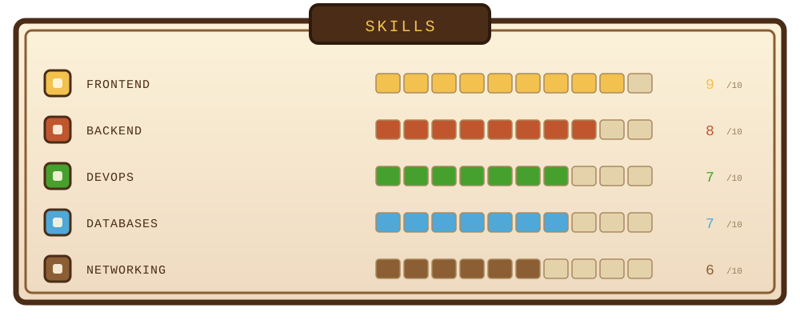
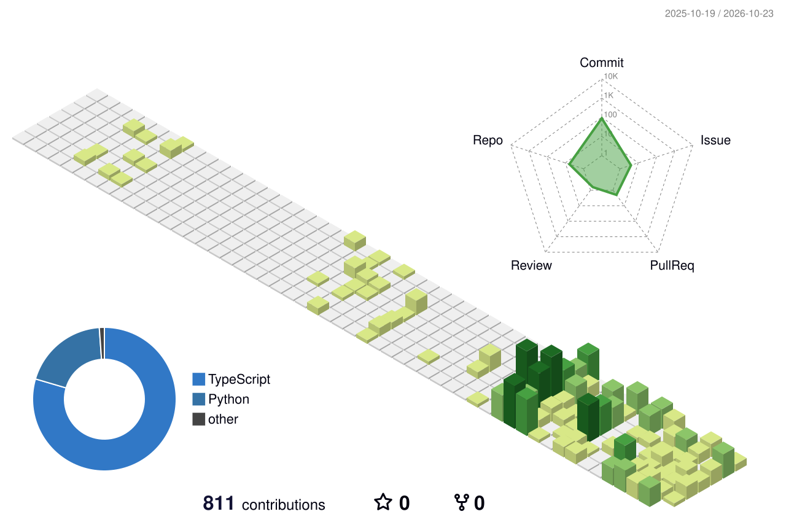
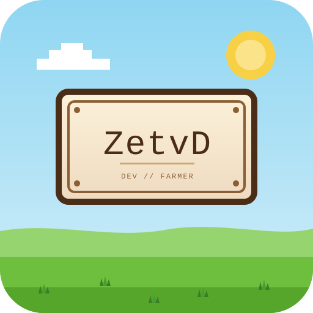

<!-- PALETTE: parchment #F4E4BC | wood #4A2C17 | gold #F2C14E | leaf #46A02E | grass #6FBF3E | sky #8FD6F2 -->



<div align="center">

[](https://git.io/typing-svg)

</div>

```ansi
$ whoami
ZetvD (minzinccs) — developer
$ cat farm.log
[>] web apps + apis
[>] typescript // react // python
[>] plant daily, harvest weekly
$ status ● online_
```

<div align="center"></div>

```text
[01 // TOOLBELT]
```

| SKILL // SLOT | TOOLS |
| :---: | :--- |
| **LANGUAGES** |      |
| **BACKEND & FRONTEND** |     |
| **HOMESTEAD & INFRA** |    |
| **BARNS & STORAGE** |     |

<div align="center"></div>

```text
[02 // SKILLS]
```

<div align="center">
  
</div>

<div align="center"></div>

```text
[03 // FARM STATS]
```

<div align="center">
  
  
</div>

<div align="center">
  
</div>

<div align="center">
  
</div>

<div align="center">
  
</div>

<div align="center"></div>

```text
[04 // BUILDS]
```

<!-- not deployed — local builds -->

| PROJECT | STACK | DESCRIPTION |
|---|---|---|
| **unknown-01** | `React` `Express` `Prisma` | Hosting billing platform |
| **unknown-02** | `PHP` `React` `Docker` | Game-server panel |
| **unknown-03** | `Python` `Docker` | Banking API wrapper |
| **unknown-04** | `Python` `Docker` | Self-hosting agent stack |
| [**haru-manager**](https://github.com/minzinccs/haru-manager) | `JavaScript` | Image curation panel |

<div align="center"></div>

```text
[05 // UPLINK]
```

<div align="center">
  
</div>

```js
const zetvd = {
  focus: ["web_apps", "apis", "open_source"],
  stack: "typescript // react // python",
  status: "ONLINE",
  season: "stardew_valley",
  collab: true,
  ping: "github.com/minzinccs",
};
```

<div align="center">
  <sub><i>“plant daily · harvest weekly — build calm, ship clean.”</i></sub>
</div>
